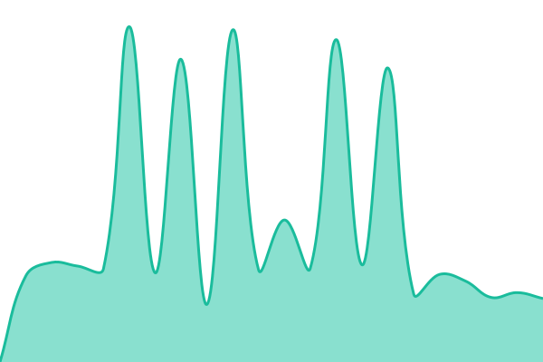
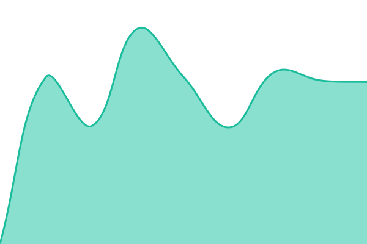

# IP-DB Status

Availability and response time monitoring for [ip-db.com](https://ip-db.com) services. Each endpoint is checked every five minutes from outside our infrastructure.

**Status page:** [status.ip-db.com](https://status.ip-db.com)

## [Live Status](https://status.ip-db.com): <!--live status--> **🟩 All systems operational**

<!--start: status pages-->
<!-- This summary is generated by Upptime (https://github.com/upptime/upptime) -->
<!-- Do not edit this manually, your changes will be overwritten -->
<!-- prettier-ignore -->
| URL | Status | History | Response Time | Uptime |
| --- | ------ | ------- | ------------- | ------ |
|  [Website](https://ip-db.com/en/) | 🟩 Up | [website.yml](https://github.com/ip-db/status/commits/HEAD/history/website.yml) | 

 1236ms
     
 | 

<a href="https://status.ip-db.com/history/website">90.11%</a>
    

|  [IP Lookup API](https://api.ip-db.com/v1/check/8.8.8.8) | 🟩 Up | [ip-lookup-api.yml](https://github.com/ip-db/status/commits/HEAD/history/ip-lookup-api.yml) | 

 1400ms
     
 | 

<a href="https://status.ip-db.com/history/ip-lookup-api">50.40%</a>
    

|  [API Gateway](https://api.ip-db.com/) | 🟩 Up | [api-gateway.yml](https://github.com/ip-db/status/commits/HEAD/history/api-gateway.yml) | 

 696ms
     
 | 

<a href="https://status.ip-db.com/history/api-gateway">90.30%</a>
    

|  [Statistics API](https://ip-db.com/stats/lookups.json) | 🟩 Up | [statistics-api.yml](https://github.com/ip-db/status/commits/HEAD/history/statistics-api.yml) | 

 728ms
     
 | 

<a href="https://status.ip-db.com/history/statistics-api">90.41%</a>
    

|  [WHOIS Lookup](https://whois.ip-db.com/en/) | 🟩 Up | [whois-lookup.yml](https://github.com/ip-db/status/commits/HEAD/history/whois-lookup.yml) | 

 1078ms
     
 | 

<a href="https://status.ip-db.com/history/whois-lookup">90.50%</a>
    

|  [API Documentation](https://ip-db.com/en/api-docs) | 🟩 Up | [api-documentation.yml](https://github.com/ip-db/status/commits/HEAD/history/api-documentation.yml) | 

 1491ms
     
 | 

<a href="https://status.ip-db.com/history/api-documentation">90.60%</a>
    

<!--end: status pages-->

## Incidents

An outage opens an issue in this repository automatically and closes it on recovery. Past incidents are listed under [Issues](https://github.com/ip-db/status/issues?q=is%3Aissue).

## Reporting a problem

If a service is not working for you while this page shows it as operational, contact us at [ip-db.com/en/contact](https://ip-db.com/en/contact).

## License

Built with [Upptime](https://upptime.js.org), released under the [MIT License](LICENSE).
